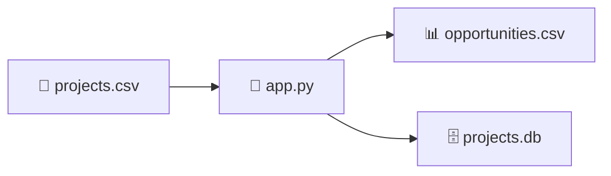
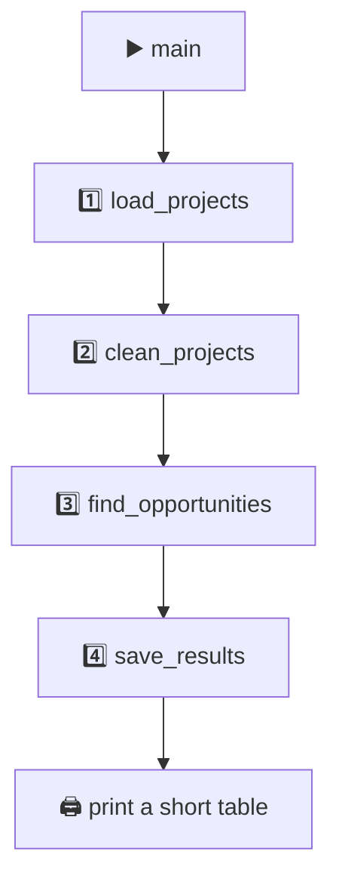
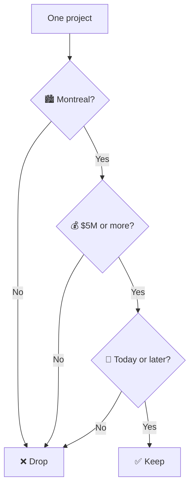

# 🏗️ Quebec Construction Project Finder

🐍 A tiny Python program. It reads a list of construction projects and **keeps a row only if all 3 things are true:**

🏙️ City is Montreal or Montréal · 💰 Value is at least **$5,000,000** CAD · 📅 Bid date is **today or later**

It saves the keepers in two places: a spreadsheet and a small database.



## 🗺️ The 4 steps





Biggest dollar value is saved first.

## 📁 Every file

| | File | What it is | When it exists |
| --- | --- | --- | --- |
| 📖 | `README.md` | This guide | Already here |
| 🐍 | `app.py` | The whole program. Nothing else runs | Already here |
| 📄 | `projects.csv` | The input list. 5 example rows | Already here. Swap in your own file |
| 📦 | `requirements.txt` | Says “install Pandas” | Already here |
| 🙈 | `.gitignore` | Tells Git which files to skip | Already here |
| 📊 | `opportunities.csv` | The matches, as a spreadsheet | Created when you run |
| 🗄️ | `projects.db` | The same matches, as a database | Created when you run |

🐍 `sqlite3`, `pathlib`, and `csv` logic come with Python. The only install is Pandas.

## ▶️ Run it

You need Python 3.

```bash
python -m pip install -r requirements.txt
python app.py
```

🍎 Mac, if `pip` says the system Python is protected:

```bash
python3 -m venv .venv
source .venv/bin/activate
python -m pip install -r requirements.txt
python app.py
```

🖨️ With the sample file you should see **0 opportunities**. That is the date gate working. Every sample bid date is **13 October 2026**, and today is after that.

👀 To see a real match, change one Montreal `bid_date` to a future day (try `2027-01-15`) and run it again:

```text
Found 2 open Montreal opportunities worth at least $5M.
                                    name     city  value_cad   bid_date
          Renovation of a Building L-042 Montreal   13350000 2027-01-15
Renovation of a Building L-042 Site Work Montreal   13350000 2027-01-15
Saved to opportunities.csv and projects.db
```

## 📄 projects.csv

One row = one project. Commas split the columns. No `$` and no commas inside the money. Dates look like `2026-10-13`.

| Column | Meaning | Used to decide? |
| --- | --- | --- |
| `project_id` | Id, kept as text | Only to drop duplicates |
| `name` | Project title | No. Saved, and shown on screen |
| `city` | Place | ✅ Yes |
| `value_cad` | Dollars, plain number | ✅ Yes |
| `bid_date` | `YYYY-MM-DD` | ✅ Yes |
| `category` | Military, Power, Roads… | No. It rides along |
| `source_url` | A link | No. It rides along |

`category` and `source_url` are kept so a later rule can use them without changing the file shape.

### 🧪 The 5 sample rows

Today is after 13 October 2026, so the date column fails for every row.

| Project | 🏙️ City | 💰 Money | 📅 Date | Result |
| --- | --- | --- | --- | --- |
| Renovation of a Building L-042 | ✅ Montreal | ✅ $13.35M | ❌ passed | ❌ out |
| L-042 Site Work | ✅ Montreal | ✅ $13.35M | ❌ passed | ❌ out |
| Portfolio of Roof Refurbishment Works | ❌ Beaumont | ✅ $80M | ❌ passed | ❌ out |
| Infrastructure at Pointe-a-la-Renommee | ❌ Gaspe | ❌ $2M | ❌ passed | ❌ out |
| Roof at Mistouk Sports Centre | ❌ Alma | ❌ $1M | ❌ passed | ❌ out |

If the dates were still in the future, only the first two rows would pass. Beaumont is huge and still out, because it is not Montreal.

The rows are short examples shaped like public listings. The link points at the ConstructConnect Quebec projects page. This program does **not** open that site. Replace `projects.csv` with an export you are allowed to use, and keep these column names.

## 🐍 app.py, name by name

| Piece | What it does | Why it is done this way |
| --- | --- | --- |
| `HERE` | The folder this script sits in | Finds `projects.csv` even if you start Python from another folder |
| `MIN_VALUE_CAD = 5_000_000` | The money cutoff | One knob to turn. The underscores are only for your eyes. Python reads `5000000` |
| `load_projects` | Reads the CSV into a table | `project_id` is text, so `06023317` would keep the leading `0`. A number would drop it |
| `.copy()` | Cleans a copy of the table | The loaded table stays as it was read |
| city clean | Blanks become `""`, spaces are trimmed | `" Montreal "` still matches Montreal |
| `to_numeric(..., errors="coerce")` | Text money becomes a number | A bad cell becomes blank (`NaN`) and fails the money gate. The program does not crash |
| `to_datetime(..., errors="coerce")` | Text dates become real dates | Same idea. A bad date fails the date gate quietly |
| `drop_duplicates` | Same `project_id` twice → keep the first | Feeds sometimes repeat a project |
| `today` | Midnight at the start of today | A bid due today still counts. Yesterday does not |
| `"montreal\|montréal"` | City must contain one of those words | `\|` means **or**. `é` is a different letter from `e`, so both spellings are listed. Any capitalization matches. `Montreal-Est` matches too, because the word is inside it |
| `>= MIN_VALUE_CAD` | Money gate | A blank value fails |
| `bid_date >= today` | Date gate | A blank or past date fails |
| `&` | All 3 gates must pass | One failure drops the row |
| `sort_values(..., ascending=False)` | Largest money first | The spreadsheet and the database are in that order |
| `to_csv(..., index=False)` | Writes `opportunities.csv` | `index=False` skips an extra 0, 1, 2 column |
| `sqlite3.connect` + `to_sql(..., if_exists="replace")` | Writes table `opportunities` inside `projects.db` | Each run replaces that table, so yesterday’s rows are not mixed with today’s. The `with` block closes the file |
| `print(...to_string...)` | Shows 4 columns: name, city, value, date | The screen stays short. The files still keep **every** column |
| `if __name__ == "__main__"` | Runs `main` when you start this file | Importing `app.py` from another file does not run the search |

Types are fixed in the clean step, not while reading. Read first. Then turn bad money and bad dates into blanks.

🗄️ Peek at the database:

```bash
sqlite3 projects.db "SELECT name, city, value_cad, bid_date FROM opportunities;"
```

Or open `projects.db` in [DB Browser for SQLite](https://sqlitebrowser.org/). No database server. The database is just that one file.

## 📦 requirements.txt

```text
pandas>=2.0
```

🐼 Pandas is the table tool. A DataFrame is Pandas’ name for a table. `projects` in `app.py` is one.

## 🙈 .gitignore

| Line | Skips | Why |
| --- | --- | --- |
| `.venv/` | The private Python install | Recreate it with `python3 -m venv .venv` |
| `__pycache__/` and `*.pyc` | Python’s scratch files | Python recreates them |
| `opportunities.csv` | The result spreadsheet | A new run writes a new one |
| `projects.db` | The result database | Same |

## 📖 Words

| Word | Means |
| --- | --- |
| 📄 CSV | Text table. One line per row. Commas between columns. Opens in Excel |
| 🐼 Pandas | Python library for tables |
| 📋 DataFrame | Pandas’ table. Rows and columns |
| 🗄️ SQLite | A database in one file. No server |
| 🔁 Pipeline | Steps in order: load → clean → filter → save |
| 📥 Ingest | Bring data in. Here, that is reading the CSV |
| ⬜ NaN | Pandas’ word for a blank |
| 🧪 `errors="coerce"` | Bad value becomes NaN instead of a crash |

## 🔧 Change the rule

| Want | Edit |
| --- | --- |
| A different dollar cutoff | `MIN_VALUE_CAD` at the top of `app.py` |
| A different city | The string `"montreal\|montréal"` inside `find_opportunities` |
| Only one category | One more line in `find_opportunities`, then `&` it with the other gates |

## 🚑 If it breaks

| You see | Do this |
| --- | --- |
| `No module named 'pandas'` | `python -m pip install -r requirements.txt` |
| `externally-managed-environment` on a Mac | Use the `.venv` commands above |
| `python: command not found` | Type `python3` instead of `python` |
| `Found 0` | Normal for the sample. The bid dates are in the past |
| A project you wanted is missing | Check the city spelling, a plain number in `value_cad`, and a `YYYY-MM-DD` date that is not in the past |

## ⏭️ Next

1. 📄 Replace `projects.csv` with a current export you are allowed to use. Keep the same columns.
2. 🎯 Add another gate, such as `category`, in `find_opportunities`.
3. ⏰ Run `python app.py` on a schedule (cron on Mac or Linux, Task Scheduler on Windows).

🚫 ConstructConnect limits automated access. Some details need a subscription. This project does not scrape the site.
